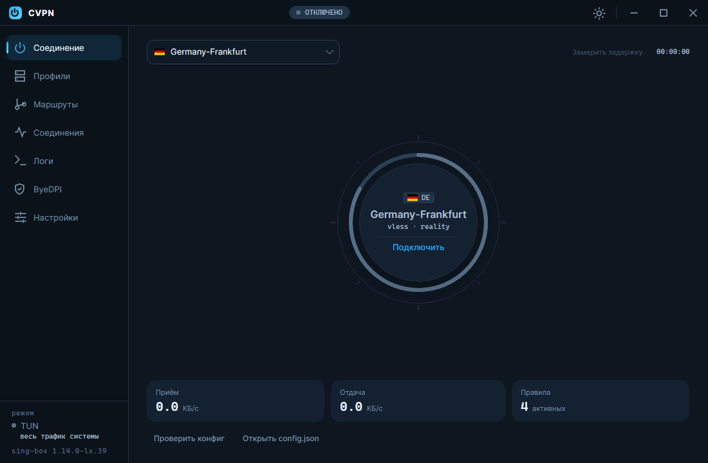
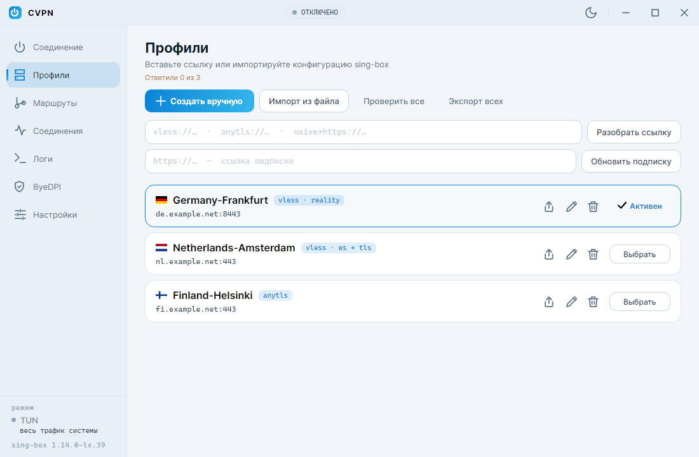
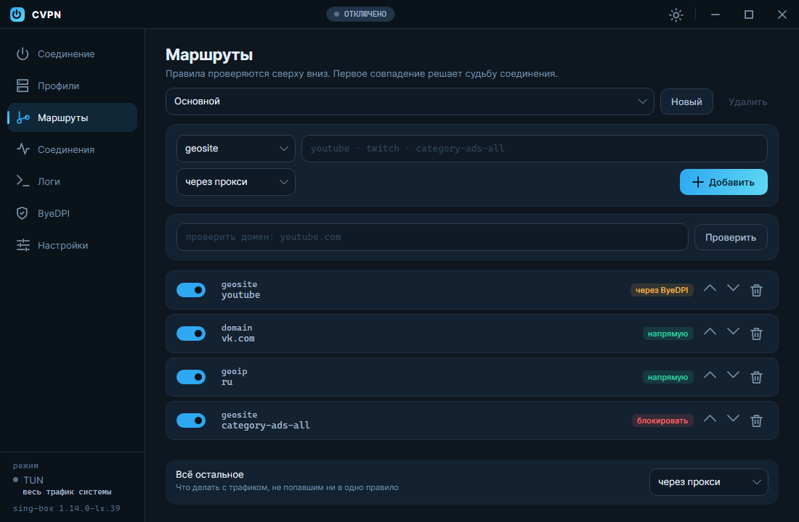
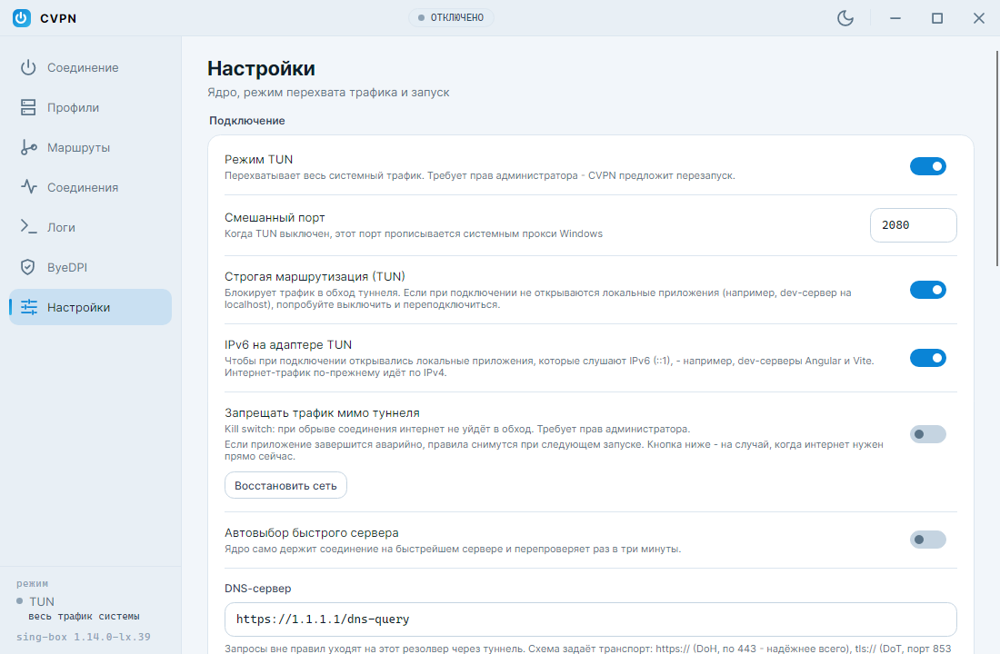

<div align="center">


# CVPN

**A [sing-box](https://github.com/SagerNet/sing-box) client with clear routing and built-in ByeDPI**

Windows · Linux · Android

[](https://github.com/13cyberpunk02/CVPN.Crossplatform/releases/latest)
[](https://github.com/13cyberpunk02/CVPN.Crossplatform/actions/workflows/tests.yml)
[](LICENSE)

[Русский](README.md) · **English**

</div>

<p align="center">
  
  
</p>

CVPN builds a sing-box configuration from your server profiles and routing rules, runs the
core and shows what happens to your traffic. No hand-editing JSON: a server is added from a
link, rules take a couple of clicks, and for sites that only need to be "unblocked" there is
ByeDPI, which uses none of your proxy traffic.

This is the cross-platform version of [CVPN for Windows](https://github.com/13CyberPunk02/CVPN),
rewritten with [Avalonia](https://avaloniaui.net). Profiles and rules from the previous
version are read as is.

> The interface is available in English and Russian. Screenshots show the Russian UI.

## Features

- **Protocols:** VLESS (Reality, WebSocket, XHTTP), AnyTLS, NaiveProxy (not on Android).
- **Profiles:** `vless://`, `anytls://`, `naive+https://` links, subscriptions, importing a
  sing-box configuration from a file, export and sharing, latency check for all servers.
- **Routing:** rules by geosite, geoip, domain, suffix, keyword, process and your own `.srs`
  rule sets. Actions: via proxy, direct, via ByeDPI, block. Several rule sets and a
  "where will this domain go" check.
- **ByeDPI** built in: sites routed "via ByeDPI" go straight to the internet, with the start
  of the connection disguised from DPI.
- **Modes:** TUN (all system traffic) or system proxy.
- **Kill switch:** Windows Firewall, nftables on Linux, the system "Always-on VPN" on Android.
- **Tunnel service:** TUN without running the app as administrator (a Windows service,
  a systemd unit).
- **Monitoring:** active connections with the rule each one matched, speed, session totals,
  core log.
- **Comfort:** auto-select the fastest server, auto-connect, start with the system, tray
  icon, dark and light themes, English and Russian.

<p align="center">
  
  
</p>

## Install

Ready-made builds are on the [releases page](https://github.com/13cyberpunk02/CVPN.Crossplatform/releases/latest).
You don't need to install .NET: it is bundled.

| System | File | How to install |
|---|---|---|
| Windows 10/11 x64 | `CVPN-<version>-setup.exe` | Run the installer |
| Windows, no install | `CVPN-<version>-portable.zip` | Unzip, run `CVPN.exe` |
| Debian, Ubuntu, Mint | `cvpn_<version>_amd64.deb` | `sudo apt install ./cvpn_<version>_amd64.deb` |
| Any Linux x64 | `CVPN-<version>-x86_64.AppImage` | `chmod +x` and run |
| Linux x64, archive | `CVPN-<version>-linux-x64.tar.gz` | Unpack, run `./CVPN` |
| Android 6+ (arm64) | `CVPN-<version>-android-arm64.apk` | Open the file on the phone, allow installation |

## Quick start

1. **Profiles**: paste a server link and press "Parse link", or enter a subscription URL.
2. **Connection**: pick a server and press the dial.
3. **Routing**, optionally: what goes direct, what via the proxy, what via ByeDPI.
   Rules are checked top to bottom; a separate setting at the bottom covers everything else.

TUN mode captures all system traffic and needs privileges. Without them, use system proxy
mode: turn off "TUN mode" in the settings.

## Platforms

### Windows

TUN needs administrator rights. Three options:

- **Tunnel service** (recommended): "Settings → TUN privileges → Tunnel service".
  Installed once, after that the app runs without asking for rights.
- **Scheduled task**: the whole app runs as administrator without a UAC prompt.
- Install nothing: CVPN offers to restart with rights when you turn TUN on.

### Linux

- **Service** (recommended): "Settings → TUN privileges → Tunnel service → Install".
  Through `pkexec` the service is copied to `/opt/cvpn` and the `cvpn-tunnel.service` unit
  is installed. Your user is added to the `cvpn` group: **access appears after you log out
  and back in**.
- **No service**: give the rights to the core itself:
  `sudo setcap cap_net_admin,cap_net_raw,cap_net_bind_service+ep <path to sing-box>`.
  Keep in mind that this gives network rights to anyone who runs that file.
- **Kill switch** is the nftables table `inet cvpn_killswitch`. To remove it in an emergency:
  `sudo nft delete table inet cvpn_killswitch`. ByeDPI traffic bypasses the tunnel, so with
  the kill switch on, sites routed via ByeDPI will not open.
- **System proxy** is set through `gsettings` (GNOME and derivatives).
- **Tray** uses StatusNotifierItem: KDE, Cinnamon, XFCE. GNOME needs the AppIndicator extension.

### Android

- On the first connection the system asks for VPN permission.
- **Kill switch** is enabled in Android settings: "Network → VPN → CVPN → Always-on VPN"
  and "Block connections without VPN".
- ByeDPI and the core are built in; no paths to set.
- arm64 only, which covers almost every phone from recent years.
- NaiveProxy is not available on Android, same as in the official sing-box build.

## Data

| System | Folder |
|---|---|
| Windows | `%AppData%\CVPN` |
| Linux | `~/.config/CVPN` |
| Android | the app's internal storage |

Passwords and UUIDs in `profiles.json` are encrypted: with DPAPI on Windows (files from the
previous version are readable), with AES-GCM and a key stored next to the data on Linux and
Android.

## FAQ

**XHTTP does not connect.** Official sing-box does not support XHTTP; the transport is added
by core forks. Set the path to such a core in "Settings → sing-box core".

**Local sites (a dev server on localhost) stop opening with TUN on.** Turn off "Strict
routing" or turn on "IPv6 on the TUN adapter" and reconnect.

**ByeDPI is running but the site does not open.** Try other arguments on the ByeDPI page.
In TUN mode on Windows, binding ciadpi to the adapter does not work everywhere; system proxy
mode helps then (details on the ByeDPI page).

**No internet after a crash with the kill switch on.** "Settings → Restore network"; on
Linux also `sudo nft delete table inet cvpn_killswitch`.

## Building from source

You need the [.NET 10 SDK](https://dotnet.microsoft.com/download/dotnet/10.0).

```
dotnet build CVPN.Desktop        # the app for Windows and Linux
dotnet test  CVPN.Tests
dotnet build CVPN.Android        # needs the workload: dotnet workload install android
```

Layout:

```
CVPN.Shared/    IPC protocol, file log - shared by the app and the service
CVPN.Core/      logic without UI: models, ConfigBuilder, link parsers, subscriptions,
                Clash API, ViewModels, platform interfaces, localization
CVPN/           shared Avalonia UI: pages, theme and UI kit, connection dial, tray
CVPN.Desktop/   entry point and platform implementations for Windows and Linux
CVPN.Service/   tunnel service: Windows service and systemd unit
CVPN.Android/   Android entry point: VpnService + hev-socks5-tunnel + sing-box
CVPN.Tests/     xUnit
packaging/      Windows installer, Linux packages, Android native libraries
```

<details>
<summary><b>Packages, Android and debugging</b></summary>

**Packages:**

```
packaging/windows/build.ps1 -Version 1.2.3     # dist\CVPN-1.2.3-setup.exe, -portable.zip
packaging/linux/build.sh 1.2.3                 # dist/*.tar.gz, *.deb, *.AppImage
```

A GitHub release is built on a `v*` tag (`.github/workflows/release.yml`); the release text
comes from `packaging/release-notes.md`. Running the workflow manually makes a trial build
without publishing.

**Android.** How it works:

```
apps ─► TUN (VpnService) ─► hev-socks5-tunnel ─► SOCKS5 127.0.0.1 ─► sing-box ─► server
```

The app itself is excluded from its own VPN, so the core's connections do not loop.
The core is built trimmed (`with_utls`, `with_clash_api`, `with_quic`): 42 MB instead of
the official 79 MB, the APK is about 31 MB. Native libraries are not stored in git:

```
bash packaging/android/build-core.sh          # the core (Linux or WSL; Go is downloaded)
pwsh packaging/android/fetch-natives.ps1      # tun2socks, ciadpi, core for the emulator
dotnet build CVPN.Android -c Release
```

If a Release build fails with "Precompiling failed" and your Windows profile path contains
non-Latin characters, that is the Mono AOT compiler: set a Latin temp folder,
`$env:TEMP = $env:TMP = "C:\tmp"`.

**Debugging.** `CVPN_DATA_DIR=<folder>` sets a custom data folder. In a Debug build:
`--page=<connection|profiles|routing|connections|logs|byedpi|settings>`,
`--theme=dark|light`, `--snapshot=file.png[|width[|height]]` and `--scroll-end` render
the window to a PNG and exit.

</details>

## Credits

- [sing-box](https://github.com/SagerNet/sing-box), the core (GPL-3.0)
- [ByeDPI](https://github.com/hufrea/byedpi), DPI circumvention (MIT)
- [hev-socks5-tunnel](https://github.com/heiher/hev-socks5-tunnel), tun2socks for Android (MIT)
- [Avalonia](https://avaloniaui.net), cross-platform UI (MIT)

## License

[MIT](LICENSE). The sing-box core ships with the app under GPL-3.0; its license text sits
next to the binary.
