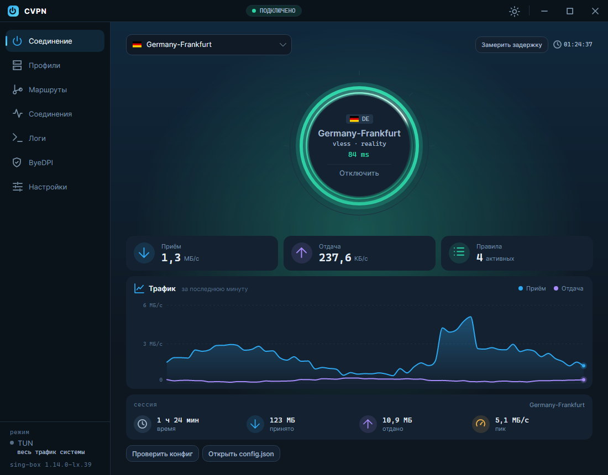
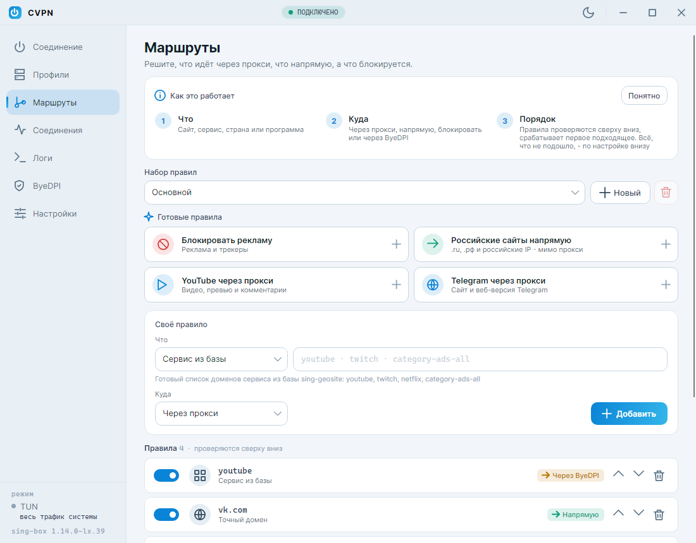
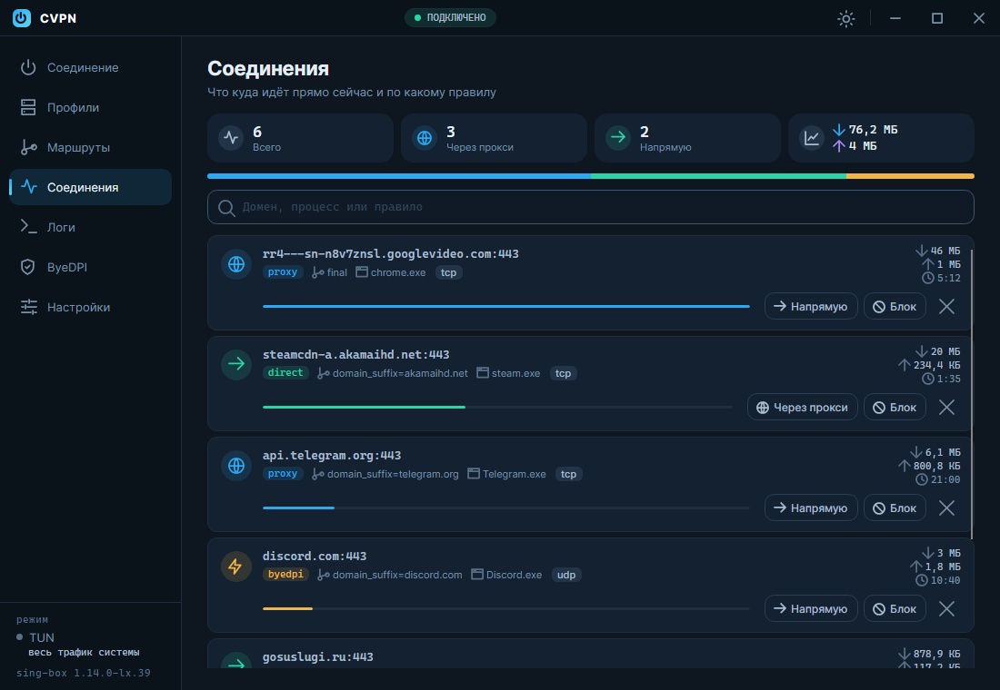
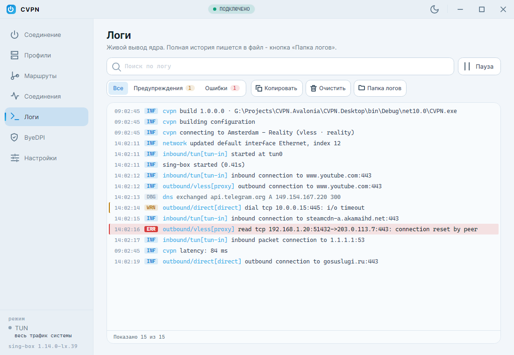
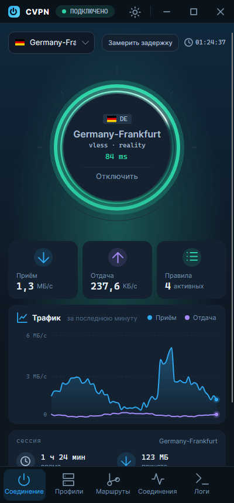
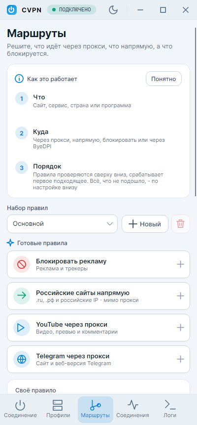
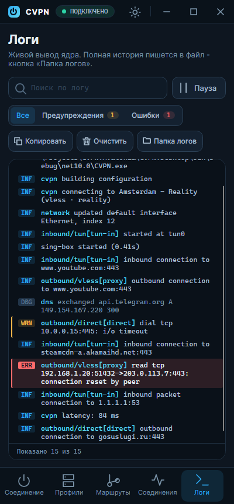

<div align="center">


# CVPN

**Клиент [sing-box](https://github.com/SagerNet/sing-box) с понятной маршрутизацией и встроенным ByeDPI**

Windows · Linux · Android

[](https://github.com/13cyberpunk02/CVPN.Crossplatform/releases/latest)
[](https://github.com/13cyberpunk02/CVPN.Crossplatform/releases)
[](https://github.com/13cyberpunk02/CVPN.Crossplatform/actions/workflows/tests.yml)
[](LICENSE)

**Русский** · [English](README.en.md)

</div>

<p align="center">
  
  
</p>

CVPN собирает конфигурацию sing-box из профилей серверов и правил маршрутизации, запускает
ядро и показывает, что происходит с трафиком. Редактировать JSON руками не нужно: сервер
добавляется ссылкой, правила задаются в пару кликов, а для сайтов, которые достаточно
«разблокировать», есть ByeDPI без расхода трафика прокси.

Это кроссплатформенная версия [CVPN для Windows](https://github.com/13CyberPunk02/CVPN),
переписанная на [Avalonia](https://avaloniaui.net). Профили и правила прежней версии
читаются как есть.

## Возможности

- **Протоколы:** VLESS (Reality, WebSocket, XHTTP), AnyTLS, NaiveProxy (кроме Android).
- **Профили:** ссылки `vless://`, `anytls://`, `naive+https://`, подписки, импорт конфигурации
  sing-box из файла, экспорт и «Поделиться», проверка задержки всех серверов.
- **Маршрутизация:** правила по geosite, geoip, домену, суффиксу, ключевому слову, процессу
  и своим наборам `.srs`. Действия: через прокси, напрямую, через ByeDPI, блокировать.
  Готовые правила в одно нажатие (реклама, российские сайты, YouTube, Telegram),
  несколько наборов правил и проверка «куда пойдёт этот сайт».
- **ByeDPI** встроен: сайты с действием «через ByeDPI» идут в интернет напрямую, но со
  скрытым от DPI началом соединения.
- **Режимы:** TUN (весь трафик системы) или системный прокси.
- **Kill switch:** Windows - брандмауэр, Linux - nftables, Android - системная
  «Постоянная VPN».
- **Служба туннеля:** TUN без запуска приложения от администратора (служба Windows,
  юнит systemd).
- **Наблюдение:** график скорости за последнюю минуту и итоги сессии; активные
  соединения с поиском и правилом, по которому каждое из них пошло; журнал ядра
  с поиском, фильтром по уровню, паузой и копированием строк.
- **Обновления из приложения:** новая версия скачивается, сверяется по SHA-256 и ставится
  сама - на Windows, Linux (AppImage, .deb) и Android.
- **Удобства:** автовыбор быстрого сервера, автоподключение, автозапуск, значок в трее,
  тёмная и светлая темы, русский и английский языки.

<p align="center">
  
  
</p>

## Установка

Готовые сборки - на странице [релизов](https://github.com/13cyberpunk02/CVPN.Crossplatform/releases/latest).
.NET ставить не нужно: он уже внутри.

| Система | Файл | Как поставить |
|---|---|---|
| Windows 10/11 x64 | `CVPN-<версия>-setup.exe` | Запустить установщик |
| Windows без установки | `CVPN-<версия>-portable.zip` | Распаковать, запустить `CVPN.exe` |
| Debian, Ubuntu, Mint | `cvpn_<версия>_amd64.deb` | `sudo apt install ./cvpn_<версия>_amd64.deb` |
| Любой Linux x64 | `CVPN-<версия>-x86_64.AppImage` | `chmod +x` и запустить |
| Linux x64, архив | `CVPN-<версия>-linux-x64.tar.gz` | Распаковать, запустить `./CVPN` |
| Android 6+ (arm64) | `CVPN-<версия>-android-arm64.apk` | Открыть файл на телефоне, разрешить установку |

Дальше CVPN обновляется сам: «Настройки → Обновления → Обновить» (начиная с версии 1.2.0).
Сам не обновляется только распакованный архив `tar.gz`: для него кнопка ведёт на страницу релиза.

## Быстрый старт

1. **Профили** - скопируйте ссылку на сервер или подписку и нажмите «Вставить из буфера».
2. **Соединение** - выберите сервер и нажмите на круг.
3. **Маршруты** - по желанию: что пускать напрямую, что через прокси, что через ByeDPI.
   Можно начать с готовых правил. Правила проверяются сверху вниз, для всего остального
   есть отдельная настройка внизу.

Режим TUN перехватывает весь трафик системы и требует прав. Без них работает
режим системного прокси: в настройках выключите «Режим TUN».

## Платформы

### Windows

TUN требует прав администратора. Три варианта:

- **Служба туннеля** (рекомендуется): «Настройки → Права на TUN → Служба туннеля».
  Ставится один раз, после этого приложение работает без запроса прав.
- **Задача планировщика**: приложение целиком запускается с правами администратора без окна UAC.
- Ничего не ставить: CVPN предложит перезапуск с правами при включении TUN.

### Linux

- **Служба** (рекомендуется): «Настройки → Права на TUN → Служба туннеля → Установить».
  Через `pkexec` служба копируется в `/opt/cvpn` и ставится юнит `cvpn-tunnel.service`.
  Пользователь добавляется в группу `cvpn`, **доступ появится после повторного входа
  в систему**.
- **Без службы** - выдать права самому ядру:
  `sudo setcap cap_net_admin,cap_net_raw,cap_net_bind_service+ep <путь к sing-box>`.
  Учтите: это права на сеть для любого, кто запустит этот файл.
- **Kill switch** - таблица nftables `inet cvpn_killswitch`. Аварийно снять:
  `sudo nft delete table inet cvpn_killswitch`. Трафик ByeDPI идёт мимо туннеля,
  поэтому при включённом kill switch сайты через ByeDPI не откроются.
- **Системный прокси** настраивается через `gsettings` (GNOME и производные).
- **Трей** - StatusNotifierItem: KDE, Cinnamon, XFCE. В GNOME нужно расширение AppIndicator.

### Android

<p align="center">
  
  
  
</p>

- При первом подключении система спросит разрешение на VPN.
- **Kill switch** включается в настройках Android: «Сеть → VPN → CVPN → Постоянная VPN»
  и «Блокировать соединения без VPN».
- ByeDPI и ядро встроены, путь к ним указывать не нужно.
- Поддерживается только arm64: это почти все телефоны последних лет.
- NaiveProxy на Android недоступен, как и в официальной сборке sing-box.
- При первом обновлении из приложения Android попросит разрешить CVPN устанавливать
  приложения: настройки откроются сами.

## Данные

| Система | Каталог |
|---|---|
| Windows | `%AppData%\CVPN` |
| Linux | `~/.config/CVPN` |
| Android | внутренний каталог приложения |

Пароли и UUID в `profiles.json` зашифрованы: на Windows через DPAPI (файлы прежней
версии читаются), на Linux и Android через AES-GCM с ключом рядом с данными.

## Частые вопросы

**XHTTP не подключается.** Официальный sing-box XHTTP не поддерживает, транспорт
добавляют форки ядра. Укажите путь к такому ядру в «Настройки → Ядро sing-box».

**После включения TUN не открываются локальные сайты (dev-сервер на localhost).**
Выключите «Строгая маршрутизация» или включите «IPv6 на адаптере TUN» и переподключитесь.

**ByeDPI запущен, но сайт не открывается.** Попробуйте другие аргументы на странице ByeDPI.
В режиме TUN на Windows привязка ciadpi к адаптеру работает не везде, тогда помогает режим
системного прокси (подробности на странице ByeDPI).

**Интернет пропал после аварийного завершения с kill switch.** «Настройки → Восстановить
сеть», на Linux также `sudo nft delete table inet cvpn_killswitch`.

## Сборка из исходников

Нужен [.NET 10 SDK](https://dotnet.microsoft.com/download/dotnet/10.0).

```
dotnet build CVPN.Desktop        # приложение для Windows и Linux
dotnet test  CVPN.Tests
dotnet build CVPN.Android        # нужна рабочая нагрузка: dotnet workload install android
```

Структура:

```
CVPN.Shared/    протокол IPC, файловый лог - общий для приложения и службы
CVPN.Core/      логика без UI: модели, ConfigBuilder, парсеры ссылок, подписки, Clash API,
                ViewModels, интерфейсы платформы, локализация
CVPN/           общий интерфейс Avalonia: страницы, тема и UI Kit, круг подключения, трей
CVPN.Desktop/   точка входа и реализации платформы для Windows и Linux
CVPN.Service/   служба туннеля: служба Windows и юнит systemd
CVPN.Android/   точка входа Android: VpnService + hev-socks5-tunnel + sing-box
CVPN.Tests/     xUnit
packaging/      установщик Windows, пакеты Linux, сборка нативных библиотек Android
```

<details>
<summary><b>Пакеты, Android и отладка</b></summary>

**Пакеты:**

```
packaging/windows/build.ps1 -Version 1.2.3     # dist\CVPN-1.2.3-setup.exe, -portable.zip
packaging/linux/build.sh 1.2.3                 # dist/*.tar.gz, *.deb, *.AppImage
```

Релиз в GitHub собирается по тегу `v*` (`.github/workflows/release.yml`), текст релиза
берётся из `packaging/release-notes.md`. Ручной запуск workflow - пробная сборка без
публикации.

**Android.** Схема работы:

```
приложения ─► TUN (VpnService) ─► hev-socks5-tunnel ─► SOCKS5 127.0.0.1 ─► sing-box ─► сервер
```

Само приложение исключено из своего VPN, поэтому соединения ядра не зацикливаются.
Ядро собирается урезанным (`with_utls`, `with_clash_api`, `with_quic`): 42 МБ вместо 79 МБ
официальной сборки, APK около 31 МБ. Нативные библиотеки в git не хранятся:

```
bash packaging/android/build-core.sh          # ядро (Linux или WSL; Go скачается сам)
pwsh packaging/android/fetch-natives.ps1      # tun2socks, ciadpi, ядро для эмулятора
dotnet build CVPN.Android -c Release
```

Если Release падает на «Precompiling failed» и в пути профиля Windows есть кириллица,
это AOT-компилятор Mono: задайте латинский временный каталог,
`$env:TEMP = $env:TMP = "C:\tmp"`.

**Отладка.** `CVPN_DATA_DIR=<каталог>` - свой каталог данных. В Debug-сборке:
`--page=<connection|profiles|routing|connections|logs|byedpi|settings>`,
`--theme=dark|light`, `--snapshot=файл.png[|ширина[|высота]]` и `--scroll-end` -
отрисовать окно в PNG и выйти, `--demo` - выдуманные трафик, соединения и строки лога
для снимков.

</details>

## Благодарности

- [sing-box](https://github.com/SagerNet/sing-box) - ядро (GPL-3.0)
- [ByeDPI](https://github.com/hufrea/byedpi) - обход DPI (MIT)
- [hev-socks5-tunnel](https://github.com/heiher/hev-socks5-tunnel) - tun2socks для Android (MIT)
- [Avalonia](https://avaloniaui.net) - кроссплатформенный интерфейс (MIT)

## Лицензия

[MIT](LICENSE). Ядро sing-box распространяется вместе с приложением под GPL-3.0,
текст лицензии лежит рядом с бинарником.
